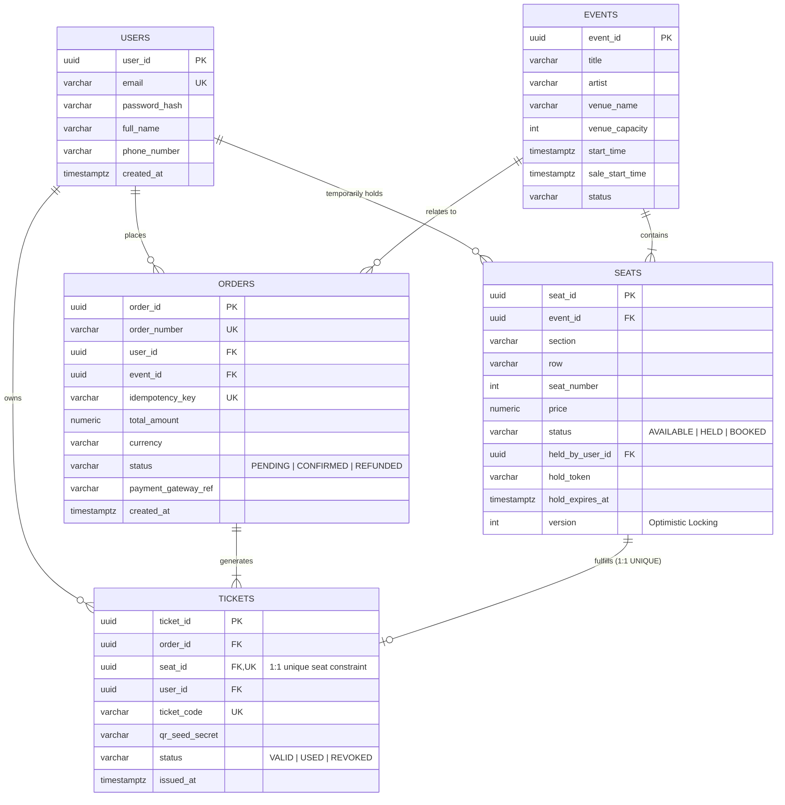
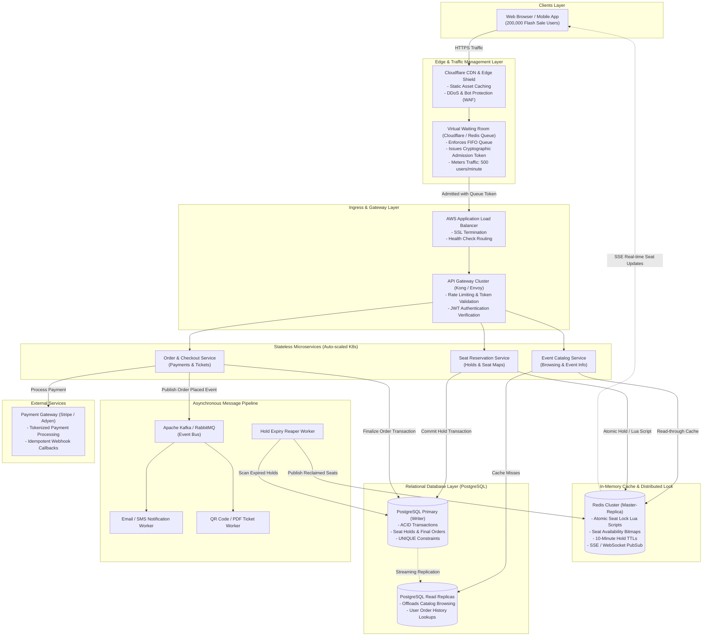

# TicketHub System Design Document

**System Name:** TicketHub  
**Domain:** High-Scale Event Ticketing & Seat Reservation Platform  
**Target Workload:** 2,000,000 Registered Users; 50,000 Daily Normal Visitors; High-Demand Flash Sales (200,000 concurrent buyers competing for 20,000 seats in 10 minutes)  
**Author:** Lead Systems Architect  
**Document Version:** 1.0.0  

---

## 1. System Requirements

### 1.1 Functional Requirements
1. **Event Browsing & Search**:
   - Users can search, filter, and paginate through upcoming concerts, sports matches, and theater events by artist, venue, genre, city, and date range.
2. **Interactive Seat Map & Availability**:
   - Users can view real-time venue seating charts with section layouts, tier pricing, and seat statuses: `AVAILABLE`, `HELD` (temporarily reserved), and `BOOKED` (sold).
3. **Temporary Seat Hold (Reservation)**:
   - Users can select up to a maximum of 4 seats and place a temporary hold for a strict **10-minute window**.
   - Held seats are locked exclusively to that user session and immediately removed from the available pool for all other buyers.
4. **Checkout & Payment Processing**:
   - Users can purchase their held seats using third-party payment gateways (e.g., Stripe, Adyen).
   - The checkout pipeline must support payment idempotency so users are never double-charged upon network retries or double-clicks.
5. **Order Confirmation & Ticket Delivery**:
   - Upon successful payment, orders transition to `CONFIRMED`, and unique digital tickets are generated with cryptographically signed, rotating QR codes (to mitigate unauthorized ticket reselling and counterfeiting).
   - Users can view purchased tickets anytime under their account profile and receive confirmation via email/SMS.
6. **Automatic Hold Expiration**:
   - If the user fails to complete checkout within the 10-minute window, the system automatically invalidates the hold and returns the seats to the `AVAILABLE` pool without human intervention.

---

### 1.2 Non-Functional Requirements

| Dimension | Requirement & Target Metric | Technical Rationale & Strategy |
| :--- | :--- | :--- |
| **Speed & Latency** | - Event browsing P99 < 100 ms<br>- Seat status query P95 < 150 ms<br>- Seat hold execution P99 < 200 ms<br>- Checkout confirmation P99 < 2.0 s | Offload catalog queries to CDN edge caches and read replicas. Utilize in-memory Redis data structures (Bitmaps / Hashes) for millisecond seat-state lookups. |
| **Correctness & Zero Double-Booking** | **Strict Consistency (Zero Over-allocations)**: It must be mathematically impossible for two users to hold or purchase the same seat. | ACID database transactions, strict PostgreSQL `UNIQUE` constraints on `(event_id, section, row, seat_number)` and `tickets(seat_id)`, combined with atomic Redis distributed reservation locks. |
| **Fairness** | First-Come, First-Served (FCFS) queuing under flash sales. Max 4 tickets per user/household. | Tokenized **Virtual Waiting Room** (queue-gated entry), CAPTCHA challenges before entering checkout, and IP/device fingerprinting to block scalper bots. |
| **High Availability & Fault Tolerance** | 99.99% uptime for core browsing and account access. Resilient to third-party payment outages. | Multi-Availability-Zone (Multi-AZ) deployment, auto-scaling stateless application nodes, and circuit breakers (e.g., Resilience4j / Envoy circuit breaking) around downstream payment gateways. |
| **Scalability** | Smooth handling of **1,000x traffic spikes** during major concert ticket drops without degradation of unrelated events. | Architectural decoupling: CDN edge caching, queue-throttled admission control, Redis in-memory locks, read/write database segregation, and asynchronous event workers. |
| **Security & Compliance** | Full PCI-DSS Level 1 compliance, TLS 1.3 encryption, signed JWT session tokens, encrypted PII. | Never store raw credit card numbers (use client-side Stripe Elements tokenization). Sign QR codes using HMAC-SHA256 with rotating dynamic salts to stop screenshot fraud. |

---

## 2. Traffic, Storage & System Estimates

### 2.1 Baseline / Normal Day Traffic Estimates
- **Registered User Base**: 2,000,000 users.
- **Daily Active Visitors (DAU)**: 50,000 users / day.
- **Page Views per User**: 10 pages / session.
- **Total Daily Page Views**:
  $$\text{Daily Page Views} = 50,000 \times 10 = 500,000 \text{ views/day}$$
- **Normal Ticket Sales**: 5,000 tickets / day.

#### Normal Requests Per Second (RPS)
- **Average Read Traffic**:
  $$\text{Read RPS}_{\text{avg}} = \frac{500,000 \text{ requests}}{86,400 \text{ seconds}} \approx 5.79 \text{ RPS}$$
- **Peak Read Traffic (Normal Day)**:
  Accounting for standard diurnal daytime distribution where peak hours experience 3x the daily average:
  $$\text{Read RPS}_{\text{peak}} \approx 5.79 \times 3 \approx 17.4 \text{ RPS} \quad (\approx 20 \text{ RPS})$$
- **Write Traffic (Transactions/sec)**:
  - 5,000 tickets sold daily. Assuming an average basket size of 2.5 tickets per order:
    $$\text{Daily Orders} = \frac{5,000}{2.5} = 2,000 \text{ orders/day}$$
  - Assuming 2 hold attempts per successful order (some holds expire or users change seats):
    $$\text{Daily Hold/Write Operations} = 2,000 \times 2 = 4,000 \text{ operations/day}$$
  - **Average Write TPS**:
    $$\text{Write TPS}_{\text{avg}} = \frac{4,000}{86,400} \approx 0.046 \text{ writes/sec}$$
  - **Peak Write TPS**: $\approx 0.15 \text{ to } 0.3 \text{ writes/sec}$.
- **Read-to-Write Ratio**:
  $$\text{Ratio} = 500,000 : 5,000 = 100 : 1 \quad (\text{Heavily Read-Dominant})$$

#### Normal Network Bandwidth & Storage
- Average HTTP response payload: $\sim 80 \text{ KB}$ (HTML, JSON metadata, optimized assets).
- Normal Daily Ingress/Egress:
  $$500,000 \times 80 \text{ KB} = 40,000,000 \text{ KB} \approx 40 \text{ GB/day}$$
- Average Bandwidth Consumption:
  $$\frac{40 \text{ GB} \times 8 \text{ bits/byte}}{86,400 \text{ s}} \approx 3.7 \text{ Mbps} \quad (0.46 \text{ MB/s})$$

---

### 2.2 Popular Concert "Big Sale" Estimates (Flash Crowd)
- **Event Scale**: 20,000 seats on sale for an elite world tour concert.
- **Incoming Demand**: 200,000 concurrent buyers arrive within the first 10 minutes (600 seconds).
- **Oversubscription Ratio**:
  $$\text{Contention Ratio} = \frac{200,000 \text{ buyers}}{20,000 \text{ seats}} = 10 : 1 \quad (\text{10 users competing for every single seat})$$

#### Big Sale Request Volume & Throughput
- **Arrival Rate**:
  $$\text{New User Arrival Rate} = \frac{200,000 \text{ users}}{600 \text{ seconds}} \approx 333.3 \text{ users/sec}$$
  *(In practice, over 50% arrive in the first 60 seconds as the drop timer hits zero).*
- **User Activity Behavior**:
  During the 10-minute scramble, each user makes approximately 18–25 interactions:
  - 2 page reloads / catalog checks.
  - 8–12 seat map polling / section zoom requests.
  - 3–5 rapid seat hold attempts (due to high contention when seats get claimed).
  - 1 checkout / payment transaction.
- **Total Requests in 10 Minutes**:
  $$\text{Total Big Sale Requests} = 200,000 \text{ users} \times 20 \text{ requests} = 4,000,000 \text{ requests in 600 s}$$
- **Sustained Read/Poll RPS**:
  $$\text{Big Sale Sustained RPS} = \frac{4,000,000}{600} \approx 6,667 \text{ RPS}$$
- **Instantaneous Peak Burst (T = 0s to T = 60s)**:
  At the exact opening second, 100,000+ cached sessions refresh simultaneously:
  $$\text{Peak Burst RPS} \approx 12,000 \text{ to } 15,000 \text{ RPS}$$

#### Big Sale Write & Contention Dynamics
- **Inventory Depletion**: All 20,000 seats will be held within the first 60–120 seconds.
- **Write Attempt Contention**:
  - 200,000 users attempting to reserve seats generates over **50,000 seat hold requests per minute** ($\approx 833 \text{ write requests/sec}$) all targeting the **exact same event ID**.
  - Without protective queuing, hundreds of database write transactions would collide on identical seat rows every millisecond.
- **Completed Write Transactions**:
  - Maximum possible successful holds: 20,000 seats (or $\sim 5,000$ basket checkouts of 4 seats each).
  - Total successful checkouts over 10 minutes: 5,000 orders / 600 s $\approx 8.33 \text{ completed checkouts/sec}$.
- **Big Sale Network Bandwidth**:
  - $6,667 \text{ RPS} \times 50 \text{ KB (seat status JSON)} \approx 333 \text{ MB/s} \approx 2.66 \text{ Gbps}$.

---

### 2.3 Traffic Comparison & Engineering Implications

```
NORMAL DAY TRAFFIC (avg 6 RPS, peak 20 RPS)
[==] 20 RPS

POPULAR CONCERT BIG SALE (sustained ~6,667 RPS, peak burst 15,000 RPS)
[====================================================================================================] 15,000 RPS
(750x to 1,000x surge!)
```

| Metric | Normal Day | Popular Concert Big Sale | Factor Increase |
| :--- | :--- | :--- | :--- |
| **Active Users (10 min)** | $\sim 350$ users | 200,000 users | **$\approx 571\times$** |
| **Total Requests (10 min)** | $\sim 3,500$ requests | 4,000,000 requests | **$\approx 1,142\times$** |
| **Average RPS** | 5.79 RPS | 6,667 RPS | **$\approx 1,151\times$** |
| **Peak Burst RPS** | $\approx 20$ RPS | $12,000 - 15,000$ RPS | **$\approx 750\times$** |
| **Write RPS (Seat Holds)** | 0.05 writes/s | $800 - 1,000$ attempts/s | **$\approx 16,000\times$ surge** |
| **Network Throughput** | 0.46 MB/s (3.7 Mbps) | 333 MB/s (2.66 Gbps) | **$\approx 720\times$** |
| **Resource Contention** | Distributed across events | Concentrated on 1 event / 20k rows | **Extreme Row Lock Contention** |

#### Crucial Architectural Takeaways:
1. **The Database Protection Imperative**: A relational database (PostgreSQL) running on standard instances can comfortably handle normal traffic (20 RPS) and clean read-replicas can handle a few thousand read queries, but **it will instantly crash if 800+ concurrent write transactions collide on the same seat rows with row-level locks**.
2. **Virtual Waiting Room is Mandatory**: We cannot allow 200,000 users direct, unmetered access to seat selection APIs. A queue must throttle admission to match the database's safe transactional throughput ($\sim 500 \text{ users/min admitted to select seats}$).
3. **In-Memory Shielding**: Redis must act as the high-speed shock absorber, handling atomic seat status checks and holds via Lua scripts in sub-millisecond time before transactions hit PostgreSQL.

---

## 3. API Design

The TicketHub API follows REST principles, uses JSON over HTTPS, enforces standard HTTP response status codes, and requires Bearer JWT authentication for sensitive operations.

### Endpoint 1: Browse Events
- **Method & Path**: `GET /api/v1/events`
- **Description**: Browse and filter upcoming events with pagination.
- **Authentication**: Public (None).
- **Query Parameters**:
  - `q` (string, optional): Search keyword (artist, tour title, venue).
  - `category` (string, optional): e.g., `CONCERT`, `SPORTS`, `THEATER`.
  - `city` (string, optional): Venue city filter.
  - `from_date` (ISO-8601 string, optional): Filter start date.
  - `page` (integer, default: 1): Page number.
  - `limit` (integer, default: 20, max: 100): Page size.
- **Response**: `200 OK`
```json
{
  "status": "success",
  "data": {
    "events": [
      {
        "id": "e4f8d9b1-5b72-4c6e-8d93-9b12a8f01c34",
        "title": "Cosmic Echoes World Tour 2026",
        "artist": "Aetheria",
        "venue": {
          "id": "v91a0c84-1234-4567-89ab-cdef01234567",
          "name": "Olympus Arena",
          "city": "Metropolis",
          "country": "US",
          "capacity": 20000
        },
        "startTime": "2026-11-20T20:00:00Z",
        "saleStartTime": "2026-10-27T10:00:00Z",
        "status": "ON_SALE",
        "minPrice": 59.50,
        "maxPrice": 250.00,
        "currency": "USD"
      }
    ],
    "pagination": {
      "currentPage": 1,
      "pageSize": 20,
      "totalRecords": 184,
      "totalPages": 10
    }
  }
}
```

---

### Endpoint 2: View Seats and Real-Time Availability
- **Method & Path**: `GET /api/v1/events/{eventId}/seats`
- **Description**: Retrieves the complete venue layout, section tiers, and real-time seat availability for an event.
- **Authentication**: Public / Client Session.
- **Headers**:
  - `If-None-Match`: `"<etag_hash>"` (supports conditional 304 Not Modified caching).
- **Path Parameters**:
  - `eventId` (UUID): Unique event identifier.
- **Response**: `200 OK`
```json
{
  "status": "success",
  "data": {
    "eventId": "e4f8d9b1-5b72-4c6e-8d93-9b12a8f01c34",
    "totalSeats": 20000,
    "availableCount": 14210,
    "heldCount": 1790,
    "bookedCount": 4000,
    "sections": [
      {
        "sectionId": "SEC-A1",
        "name": "Floor VIP Front",
        "tier": "VIP",
        "price": 250.00,
        "seats": [
          { "seatId": "st-00101", "row": "1", "num": 1, "status": "AVAILABLE" },
          { "seatId": "st-00102", "row": "1", "num": 2, "status": "HELD" },
          { "seatId": "st-00103", "row": "1", "num": 3, "status": "BOOKED" }
        ]
      }
    ]
  }
}
```

---

### Endpoint 3: Hold Seats (Temporary 10-Minute Lock)
- **Method & Path**: `POST /api/v1/events/{eventId}/seats/hold`
- **Description**: Places a temporary, atomic 10-minute hold on up to 4 selected seats for the authenticated user.
- **Authentication**: Required (`Authorization: Bearer <jwt_user_token>`).
- **Headers**:
  - `X-Queue-Token`: Cryptographically signed token from Virtual Waiting Room (required during flash sales).
- **Request Body**:
```json
{
  "seatIds": ["st-00101", "st-00104"]
}
```
- **Response**: `201 Created`
```json
{
  "status": "success",
  "data": {
    "holdToken": "hld_98d7f6a5b4c3e21074a8",
    "eventId": "e4f8d9b1-5b72-4c6e-8d93-9b12a8f01c34",
    "heldSeats": [
      { "seatId": "st-00101", "section": "SEC-A1", "row": "1", "num": 1, "price": 250.00 },
      { "seatId": "st-00104", "section": "SEC-A1", "row": "1", "num": 4, "price": 250.00 }
    ],
    "subtotalAmount": 500.00,
    "serviceFee": 50.00,
    "totalAmount": 550.00,
    "currency": "USD",
    "heldAt": "2026-10-27T10:02:15Z",
    "expiresAt": "2026-10-27T10:12:15Z",
    "remainingTimeSeconds": 600
  }
}
```
- **Error Responses**:
  - `409 Conflict`: One or more selected seats were already held or purchased by another user.
    ```json
    {
      "status": "error",
      "code": "SEATS_ALREADY_RESERVED",
      "message": "Seat st-00101 was claimed by another customer. Please select different seats.",
      "unavailableSeats": ["st-00101"]
    }
    ```
  - `400 Bad Request`: Exceeded maximum seat hold limit (e.g., requested 5 seats, max allowed is 4).
  - `403 Forbidden`: Invalid or expired queue token from Virtual Waiting Room.

---

### Endpoint 4: Pay & Confirm Order (Checkout)
- **Method & Path**: `POST /api/v1/orders/checkout`
- **Description**: Finalizes checkout, authorizes payment via Stripe/payment gateway, transitions seat status from `HELD` to `BOOKED`, and issues tickets.
- **Authentication**: Required (`Authorization: Bearer <jwt_user_token>`).
- **Headers**:
  - `Idempotency-Key`: `"<uuidv4>"` (Ensures retries due to network hiccups do not double-charge or create duplicate orders).
- **Request Body**:
```json
{
  "holdToken": "hld_98d7f6a5b4c3e21074a8",
  "paymentMethod": {
    "provider": "STRIPE",
    "paymentToken": "pm_1O7c9a2eZvKYlo2CLp09xyZ1"
  },
  "billingDetails": {
    "fullName": "Jane Doe",
    "email": "jane.doe@example.com",
    "addressLine1": "742 Evergreen Terrace",
    "city": "Springfield",
    "postalCode": "97477",
    "country": "US"
  }
}
```
- **Response**: `200 OK`
```json
{
  "status": "success",
  "data": {
    "orderId": "ord_550e8400-e29b-41d4-a716-446655440000",
    "orderNumber": "TH-20261027-88912",
    "orderStatus": "CONFIRMED",
    "paymentStatus": "PAID",
    "totalAmount": 550.00,
    "currency": "USD",
    "paymentGatewayRef": "ch_3N8c1a2eZvKYlo2C01j8k9L",
    "confirmedAt": "2026-10-27T10:05:42Z",
    "ticketSummary": [
      { "ticketId": "tkt_01a", "seatId": "st-00101", "seatLabel": "Sec A1, Row 1, Seat 1" },
      { "ticketId": "tkt_02b", "seatId": "st-00104", "seatLabel": "Sec A1, Row 1, Seat 4" }
    ],
    "receiptUrl": "https://tickethub.com/receipts/ord_550e8400"
  }
}
```
- **Error Responses**:
  - `410 Gone`: Seat hold has expired. The seats were released back to the general pool.
  - `402 Payment Required`: Payment authorization declined by bank.

---

### Endpoint 5: View Purchased Tickets
- **Method & Path**: `GET /api/v1/users/me/tickets`
- **Description**: Retrieves all valid tickets purchased by the authenticated user, complete with dynamic anti-fraud QR code payloads.
- **Authentication**: Required (`Authorization: Bearer <jwt_user_token>`).
- **Query Parameters**:
  - `status` (optional): `VALID`, `USED`, `EXPIRED`.
- **Response**: `200 OK`
```json
{
  "status": "success",
  "data": {
    "tickets": [
      {
        "ticketId": "tkt_01a-88f2-491e-9201",
        "orderId": "ord_550e8400-e29b-41d4-a716-446655440000",
        "event": {
          "title": "Cosmic Echoes World Tour 2026",
          "artist": "Aetheria",
          "venue": "Olympus Arena",
          "startTime": "2026-11-20T20:00:00Z"
        },
        "seat": {
          "section": "Floor VIP Front",
          "row": "1",
          "seatNumber": 1
        },
        "status": "VALID",
        "ticketCode": "TH-TKT-99182371",
        "dynamicQrToken": "eyJhbGciOiJIUzI1NiIsInR5cCI6IkpXVCJ9.eydGt0IjoidGt0XzAxYSIsInRzIjoxNzYxNTYxOTQyfQ.SflKxwRJSMeKKF2QT4fwpMeJf36POk6yJV_adQssw5c",
        "qrRefreshWindowSeconds": 30
      }
    ]
  }
}
```

---

## 4. Data Model

The data model uses PostgreSQL to provide strict relational integrity, foreign key cascading constraints, check constraints, and transactional consistency.

### 4.1 Relational Database Schema (PostgreSQL DDL)

```sql
-- 1. USERS TABLE
CREATE TABLE users (
    user_id UUID PRIMARY KEY DEFAULT gen_random_uuid(),
    email VARCHAR(255) NOT NULL UNIQUE,
    password_hash VARCHAR(255) NOT NULL,
    full_name VARCHAR(120) NOT NULL,
    phone_number VARCHAR(32),
    created_at TIMESTAMPTZ NOT NULL DEFAULT NOW(),
    updated_at TIMESTAMPTZ NOT NULL DEFAULT NOW()
);

-- 2. EVENTS TABLE
CREATE TABLE events (
    event_id UUID PRIMARY KEY DEFAULT gen_random_uuid(),
    title VARCHAR(255) NOT NULL,
    artist VARCHAR(255) NOT NULL,
    venue_name VARCHAR(255) NOT NULL,
    venue_capacity INTEGER NOT NULL CHECK (venue_capacity > 0),
    start_time TIMESTAMPTZ NOT NULL,
    end_time TIMESTAMPTZ,
    sale_start_time TIMESTAMPTZ NOT NULL,
    status VARCHAR(32) NOT NULL DEFAULT 'DRAFT' 
        CHECK (status IN ('DRAFT', 'UPCOMING', 'ON_SALE', 'SOLD_OUT', 'CANCELLED', 'COMPLETED')),
    created_at TIMESTAMPTZ NOT NULL DEFAULT NOW(),
    updated_at TIMESTAMPTZ NOT NULL DEFAULT NOW()
);

-- 3. SEATS TABLE
CREATE TABLE seats (
    seat_id UUID PRIMARY KEY DEFAULT gen_random_uuid(),
    event_id UUID NOT NULL REFERENCES events(event_id) ON DELETE CASCADE,
    section VARCHAR(32) NOT NULL,
    row VARCHAR(16) NOT NULL,
    seat_number INTEGER NOT NULL,
    tier_name VARCHAR(32) NOT NULL,
    price NUMERIC(10, 2) NOT NULL CHECK (price >= 0),
    status VARCHAR(20) NOT NULL DEFAULT 'AVAILABLE' 
        CHECK (status IN ('AVAILABLE', 'HELD', 'BOOKED')),
    held_by_user_id UUID REFERENCES users(user_id) ON DELETE SET NULL,
    hold_token VARCHAR(64),
    hold_expires_at TIMESTAMPTZ,
    version INTEGER NOT NULL DEFAULT 1, -- Optimistic Concurrency Control
    created_at TIMESTAMPTZ NOT NULL DEFAULT NOW(),
    updated_at TIMESTAMPTZ NOT NULL DEFAULT NOW(),
    -- Enforce physical seat uniqueness per event
    CONSTRAINT uq_event_section_row_seat UNIQUE (event_id, section, row, seat_number)
);

-- 4. ORDERS TABLE
CREATE TABLE orders (
    order_id UUID PRIMARY KEY DEFAULT gen_random_uuid(),
    order_number VARCHAR(32) NOT NULL UNIQUE,
    user_id UUID NOT NULL REFERENCES users(user_id) ON DELETE RESTRICT,
    event_id UUID NOT NULL REFERENCES events(event_id) ON DELETE RESTRICT,
    idempotency_key VARCHAR(128) NOT NULL UNIQUE,
    total_amount NUMERIC(10, 2) NOT NULL CHECK (total_amount >= 0),
    currency VARCHAR(3) NOT NULL DEFAULT 'USD',
    status VARCHAR(20) NOT NULL DEFAULT 'PENDING' 
        CHECK (status IN ('PENDING', 'CONFIRMED', 'FAILED', 'EXPIRED', 'REFUNDED')),
    payment_gateway_ref VARCHAR(128),
    created_at TIMESTAMPTZ NOT NULL DEFAULT NOW(),
    updated_at TIMESTAMPTZ NOT NULL DEFAULT NOW()
);

-- 5. TICKETS TABLE
CREATE TABLE tickets (
    ticket_id UUID PRIMARY KEY DEFAULT gen_random_uuid(),
    order_id UUID NOT NULL REFERENCES orders(order_id) ON DELETE CASCADE,
    seat_id UUID NOT NULL UNIQUE REFERENCES seats(seat_id) ON DELETE RESTRICT, -- CRITICAL: A seat can only map to ONE ticket
    user_id UUID NOT NULL REFERENCES users(user_id) ON DELETE RESTRICT,
    ticket_code VARCHAR(64) NOT NULL UNIQUE,
    qr_seed_secret VARCHAR(64) NOT NULL,
    status VARCHAR(20) NOT NULL DEFAULT 'VALID' 
        CHECK (status IN ('VALID', 'USED', 'REVOKED')),
    issued_at TIMESTAMPTZ NOT NULL DEFAULT NOW()
);

-- Essential Performance Indexes
CREATE INDEX idx_events_status_sale ON events (status, sale_start_time);
CREATE INDEX idx_seats_event_status ON seats (event_id, status);
CREATE INDEX idx_seats_hold_expiry ON seats (hold_expires_at) WHERE status = 'HELD';
CREATE INDEX idx_orders_user_created ON orders (user_id, created_at DESC);
CREATE INDEX idx_tickets_user_id ON tickets (user_id);
```

---

### 4.2 Entity Relationship Diagram (ERD)



---

## 5. Preventing Double-Booking: Transactions, Constraints & Concurrency

The defining engineering requirement of TicketHub is **absolute prevention of double-booking**. When 200,000 users attempt to purchase 20,000 seats, thousands of users will simultaneously click the exact same popular seat (e.g., Section A1, Row 1, Seat 1).

We implement **Defense-in-Depth** across four cooperating layers:

```
+-----------------------------------------------------------------------------------------+
| Layer 1: Virtual Waiting Room (FCFS Queue Token Admission Gate)                         |
|   -> Reduces incoming concurrent seat-selectors from 200,000 to ~500 users/minute       |
+-----------------------------------------------------------------------------------------+
                                          |
                                          v
+-----------------------------------------------------------------------------------------+
| Layer 2: In-Memory Redis Distributed Atomic Lock with TTL                               |
|   -> Single-threaded Redis Lua Script evaluates availability and executes atomic SETNX  |
+-----------------------------------------------------------------------------------------+
                                          |
                                          v
+-----------------------------------------------------------------------------------------+
| Layer 3: Relational ACID Transactions with Optimistic Concurrency Control               |
|   -> UPDATE ... WHERE seat_id = :id AND status = 'AVAILABLE' AND version = :v           |
+-----------------------------------------------------------------------------------------+
                                          |
                                          v
+-----------------------------------------------------------------------------------------+
| Layer 4: Hard Database Constraints (Unbreakable Safety Net)                             |
|   -> UNIQUE (event_id, section, row, seat_number) & UNIQUE (seat_id) on tickets         |
+-----------------------------------------------------------------------------------------+
```

### 5.1 Layer 2: Redis Distributed Atomic Hold (The Fast-Path Shield)
Before touching PostgreSQL, the application verifies and claims the seat in Redis. Because Redis is single-threaded for command execution, it eliminates race conditions in memory:

```lua
-- Redis Lua Script: atomic_hold_seats.lua
-- KEYS: List of seat lock keys, e.g., {'seat_lock:st-00101', 'seat_lock:st-00104'}
-- ARGV: {hold_token, user_id, ttl_seconds (600)}

local hold_token = ARGV[1]
local user_id = ARGV[2]
local ttl = tonumber(ARGV[3])

-- Step 1: Verify ALL requested seats are free
for i, key in ipairs(KEYS) do
    if redis.call("EXISTS", key) == 1 then
        return {0, key} -- Seat already held! Fail fast, return contested key
    end
end

-- Step 2: Atomically acquire locks for all requested seats with 10-min TTL
for i, key in ipairs(KEYS) do
    redis.call("SET", key, hold_token .. ":" .. user_id, "EX", ttl)
end

return {1, "OK"} -- Success! All seats locked atomically
```
- If another user attempts to hold any of the seats during the same millisecond, the Redis script returns `{0, contested_key}` in $< 1 \text{ ms}$, failing fast and shielding PostgreSQL from deadlocks or CPU saturation.

---

### 5.2 Layer 3: Database ACID Transaction with Optimistic Locking
Once the Redis lock is acquired, the application commits the temporary hold in PostgreSQL inside an explicit ACID transaction:

```sql
BEGIN;

-- Attempt to hold all selected seats in a single atomic update.
-- Optimistic condition: status MUST be AVAILABLE, OR it was held previously but the hold expired.
UPDATE seats
SET status = 'HELD',
    held_by_user_id = :userId,
    hold_token = :holdToken,
    hold_expires_at = NOW() + INTERVAL '10 minutes',
    version = version + 1,
    updated_at = NOW()
WHERE seat_id IN (:seatId1, :seatId2)
  AND (status = 'AVAILABLE' OR (status = 'HELD' AND hold_expires_at < NOW()));

-- Application checks: Did the number of affected rows EQUAL the number of requested seats?
-- If affected_rows != requested_seats_count:
--   ROLLBACK;
--   Delete acquired Redis keys;
--   Return HTTP 409 Conflict;
-- Else:
--   COMMIT;
--   Return HTTP 201 Created with holdToken and expiresAt.
```

---

### 5.3 Layer 3 & 4: Two-Phase Checkout & Final Seat Purchase
When the customer submits their payment, the order is confirmed using an ACID transaction:

```sql
BEGIN TRANSACTION ISOLATION LEVEL READ COMMITTED;

-- 1. Validate that the hold is still active and owned by this user
SELECT seat_id, price 
FROM seats 
WHERE seat_id IN (:seatId1, :seatId2)
  AND status = 'HELD'
  AND hold_token = :holdToken
  AND held_by_user_id = :userId
  AND hold_expires_at > NOW()
FOR UPDATE; -- Row-level lock prevents hold from expiring mid-checkout

-- If row count != requested count: 
--   ROLLBACK; 
--   Return 410 Gone ("Hold expired before checkout completed").

-- 2. Transition seats to BOOKED permanently
UPDATE seats 
SET status = 'BOOKED',
    held_by_user_id = NULL,
    hold_token = NULL,
    hold_expires_at = NULL,
    version = version + 1,
    updated_at = NOW()
WHERE seat_id IN (:seatId1, :seatId2);

-- 3. Insert confirmed Order record (idempotency key prevents duplicate orders)
INSERT INTO orders (order_id, order_number, user_id, event_id, idempotency_key, total_amount, currency, status, payment_gateway_ref)
VALUES (:orderId, :orderNumber, :userId, :eventId, :idempotencyKey, :totalAmount, 'USD', 'CONFIRMED', :paymentRef);

-- 4. Issue Tickets with UNIQUE(seat_id) constraint
INSERT INTO tickets (ticket_id, order_id, seat_id, user_id, ticket_code, qr_seed_secret, status)
VALUES 
    (:ticketId1, :orderId, :seatId1, :userId, :code1, :secret1, 'VALID'),
    (:ticketId2, :orderId, :seatId2, :userId, :code2, :secret2, 'VALID');

COMMIT;
```

#### Why the Hard Database Constraints Prevent Any Edge Case
Even in the theoretical event of application server bugs, network partitions, or split-brain conditions:
1. `tickets.seat_id` is defined as `UNIQUE`. If two simultaneous checkout transactions ever attempted to confirm tickets for `seatId1`, the database engine's B-Tree unique index constraint immediately throws a `23505 unique_violation` SQL error on the second transaction, aborting it cleanly.
2. The `orders.idempotency_key` unique constraint ensures payment retries from double-clicking users never create duplicate charge records.

---

### 5.4 Automatic Hold Expiration & Seat Reclamation
How do held seats become available again if a user abandons checkout?
1. **In-Memory TTL**: The Redis key expires after 600 seconds, releasing the fast-path lock automatically.
2. **Lazy Read Evaluation**: Any query viewing or attempting to hold seats checks `(status = 'AVAILABLE' OR (status = 'HELD' AND hold_expires_at < NOW()))`. Expired seats are treated as immediately claimable.
3. **Active Background Cleaner (Reaper Worker)**:
   A lightweight scheduled worker runs every 15 seconds:
   ```sql
   UPDATE seats
   SET status = 'AVAILABLE',
       held_by_user_id = NULL,
       hold_token = NULL,
       hold_expires_at = NULL,
       version = version + 1
   WHERE status = 'HELD' 
     AND hold_expires_at < NOW();
   ```
   Reclaimed seats are published to a Redis Pub/Sub channel so connected client browsers receive instant updates via Server-Sent Events (SSE).

---

## 6. System Architecture & Surviving the Big Sale

### 6.1 End-to-End Architecture Diagram



---

### 6.2 Component Explanations

1. **Cloudflare CDN & Edge Shield**:
   - Absorbs 100% of static asset traffic (HTML, CSS, JS, venue SVGs, sponsor media).
   - Serves cached event catalog listings (`/api/v1/events`), absorbing **98% of browse traffic** before it ever hits the origin infrastructure.
   - WAF (Web Application Firewall) blocks known botnets, credential stuffers, and headless browser scrapers.

2. **Virtual Waiting Room (Queue Gate)**:
   - When a popular concert drop begins, incoming users for that event are diverted to an edge-hosted Virtual Waiting Room.
   - Users are placed in a fair First-In, First-Out (FIFO) queue and given their queue position and estimated wait time.
   - The waiting room steadily meters users into the ticket selection flow at a sustainable rate (e.g., 500 users per minute), issuing cryptographically signed JWT `X-Queue-Token` headers. The API Gateway rejects any seat-hold requests lacking a valid admission token.

3. **API Gateway (Kong / Envoy)**:
   - Performs centralized SSL termination, validates queue admission tokens, verifies JWT user authentication, and applies strict per-IP rate limiting (e.g., max 10 hold requests/minute per IP) to prevent script-driven seat grabbing.

4. **Stateless Microservice Tier (Kubernetes Pods)**:
   - **Event Catalog Service**: Read-heavy, horizontally scaled; queries Redis caches and read replicas.
   - **Seat Reservation Service**: Handles seat availability queries and runs Redis atomic hold scripts.
   - **Order & Checkout Service**: Manages idempotent transactions, coordinates third-party payment requests, and creates orders.
   - Because all application services are completely stateless, Kubernetes Horizontal Pod Autoscaler (HPA) automatically scales the pods from 10 to 100+ instances in response to CPU and request queue depth.

5. **Redis Cluster (In-Memory Cache & Distributed Lock)**:
   - High-performance, in-memory cluster running in multi-AZ master-replica mode.
   - Stores venue seat availability bitmaps for sub-millisecond querying.
   - Executes atomic Lua scripts for seat holds, providing immediate locking with a 10-minute TTL.

6. **PostgreSQL Database Cluster (Primary + Read Replicas)**:
   - **Primary Writer**: Dedicated solely to write transactions (seat holds, checkouts, and user registrations). Hosted on an AWS Aurora PostgreSQL instance with provisioned IOPS.
   - **Read Replicas**: Multiple read-only replicas serve historical user ticket views, administrative reporting, and catalog queries that miss the Redis cache, completely isolating the Primary DB from read contention.

7. **Asynchronous Message Queue (Apache Kafka / RabbitMQ) & Background Workers**:
   - Decouples non-critical tasks from the synchronous checkout path.
   - As soon as the checkout transaction commits in PostgreSQL, an `OrderConfirmed` event is produced to Kafka.
   - Specialized worker pools consume events to generate dynamic PDF tickets, compute cryptographic QR salts, send confirmation emails via SendGrid, and notify SMS gateways, keeping checkout response latency $< 1.5 \text{ seconds}$.

8. **External Payment Gateway (Stripe / Adyen)**:
   - Handles secure credit card tokenization and authorization. Interfaced using client-side payment tokens and strict backend idempotency keys.

---

### 6.3 How the Architecture Survives the Big Sale (Step-by-Step Scenario)

```
Time: 09:59:50 AM  -> 200,000 fans gather on TicketHub for a 10:00 AM World Tour drop.
Time: 10:00:00 AM  -> Doors open. A tidal wave of 200,000 concurrent users strikes.
```

1. **Step 1: Edge Absorption (T = 0s)**:
   - The 200,000 users hitting the page hit Cloudflare edge nodes first. Static assets and initial event metadata are served directly from edge cache. Origin servers see virtually zero static asset load.
2. **Step 2: Traffic Leveling via Virtual Waiting Room (T = 0s to 10m)**:
   - Instead of 200,000 users hitting the seat reservation backend simultaneously, the Virtual Waiting Room catches all 200,000 visitors.
   - The queue admits **500 users every minute** into the active seating chart.
   - Over the 10-minute sale window, approximately 5,000 highly qualified buyers are admitted to choose from the 20,000 seats (average 4 tickets per buyer).
   - The database primary writer sees a smooth, controlled stream of $\approx 8 - 15 \text{ write transactions/sec}$—comfortably below its physical threshold of 2,500 TPS.
3. **Step 3: Fast-Path Contention Shielding via Redis (T = 10s to 120s)**:
   - For users admitted to the seat map, multiple users may attempt to click the same VIP front-row seats.
   - The Seat Reservation Service executes the atomic Redis Lua script. The first user gets the lock in 0.8 ms; the remaining users are rejected by Redis in 0.4 ms with `409 Conflict`.
   - **Not a single contested seat query causes a database row lock or deadlock in PostgreSQL.**
4. **Step 4: Safe ACID Commit & Ticket Generation (T = 30s to 10m)**:
   - Admitted users enter payment details within their 10-minute hold window.
   - Checkout commits cleanly on the Primary DB with zero row contention.
   - Order confirmation events are pushed to Kafka. Customers see their order confirmation screen immediately, while receipt emails and PDF generation happen in the background.
5. **Outcome**:
   - **Zero downtime**: System load remains stable.
   - **Zero double-booking**: Every seat is sold exactly once.
   - **Fairness guaranteed**: Genuine fans in the queue get tickets; bots are filtered out at the edge.

---

## 7. System Trade-Offs

In designing TicketHub, several fundamental architectural trade-offs were evaluated:

### Trade-Off 1: Redis In-Memory Hold + DB Optimistic Locking vs. Pure Database Pessimistic Locking (`SELECT FOR UPDATE`)

| Dimension | Chosen Approach: Hybrid Redis Lock + DB Optimistic Locking | Alternative: Pure Database Pessimistic Locking (`SELECT FOR UPDATE`) |
| :--- | :--- | :--- |
| **Throughput & Concurrency** | **Extremely High**: Redis resolves thousands of concurrent seat conflicts in memory ($\sim 100,000 \text{ ops/sec}$). PostgreSQL only processes uncontested, valid hold transactions. | **Very Low under high contention**: Hundreds of transactions waiting on identical row-level locks create massive lock queues, high CPU context switching, connection pool starvation, and database deadlocks. |
| **Latency** | Sub-millisecond failure response ($< 2 \text{ ms}$) when seats are already claimed. | High latency ($500 \text{ ms} - 5,000 \text{ ms}$) as competing transactions block waiting for lock release or timeout. |
| **System Complexity** | **Higher**: Introduces a distributed system dependency (Redis Cluster). Requires careful handling of cache-database synchronization and dual TTL management. | **Lower**: Kept entirely within PostgreSQL with straightforward ACID transactions; fewer moving parts to manage. |
| **Failure Mode** | If Redis fails, fallback mechanisms or cluster failovers must trigger without allowing double-allocations. | If DB locks pile up, the entire database instance locks up, cascading failures across all unrelated events. |

**Rationale for Choice**:  
During a 200,000-user sale for 20,000 seats, pure database pessimistic locking (`SELECT ... FOR UPDATE`) is fatal. The volume of simultaneous row lock acquisitions would exhaust PostgreSQL connection pools within seconds. Deflecting conflicting seat claims to single-threaded Redis Lua scripts absorbs the shockwave and preserves database health.

---

### Trade-Off 2: Virtual Waiting Room (Queue Gate) vs. Unmetered Elastic Auto-Scaling

| Dimension | Chosen Approach: Virtual Waiting Room (Queue-Gated Entry) | Alternative: Unmetered Elastic Auto-Scaling |
| :--- | :--- | :--- |
| **User Experience (UX)** | Transparent, predictable queue position with estimated wait time and fair FIFO entry. Minimal in-app errors or crashes. | Frustrating "lottery" experience: users experience slow page loads, timeouts, 502/504 errors, and repeated "seat taken" error toasts as thousands fight in real time. |
| **Infrastructure Cost** | **Economical & Predictable**: System sized for steady-state throughput (e.g., 500 admissions/min). No need to over-provision massive database instances for brief 10-minute bursts. | **Prohibitively Expensive**: Requires provisioning massive DB instances (e.g., `db.r6g.16xlarge` with 64 vCPUs) that sit 99% idle during normal operating days. |
| **System Reliability** | **Near 100%**: Guarantees total incoming system load never exceeds the database's proven write capacity. | **High Risk of Outage**: Auto-scaling application pods cannot solve the bottleneck on the single primary relational database writer. |
| **Fairness & Bot Defense** | Excellent: Queue can enforce browser fingerprinting, rate limiting, and CAPTCHA before issuing admission tokens. | Poor: Fast automated bot scripts overwhelm human clicks every time. |

**Rationale for Choice**:  
While an unmetered approach appears more convenient on paper, in reality, a primary relational database cannot be horizontally auto-scaled for writes. The Virtual Waiting Room transforms an unpredictable 200,000-user flash spike into a smooth, predictable, and fair 500-user/minute pipeline, guaranteeing 100% uptime and mathematical correctness.

---

### Trade-Off 3: Synchronous Two-Phase Hold vs. Pure Asynchronous Event-Driven Booking Queue

| Dimension | Chosen Approach: Synchronous Two-Phase Hold (Hold $\rightarrow$ Pay) | Alternative: Pure Asynchronous Booking Queue (Submit $\rightarrow$ Wait for Email) |
| :--- | :--- | :--- |
| **User Experience** | **Superior Interactive UX**: The user picks specific seats on an interactive map, receives immediate confirmation of their 10-minute hold, and proceeds confidently to checkout knowing their seats are secured. | **Inferior/Disorienting UX**: User requests "any 2 seats in Section A", joins a queue, and must wait minutes to hours to learn if their booking was successful or rejected. |
| **Engineering Simplicity** | Requires managing stateful seat expiration timers, distributed hold tokens, and background expiry cleaner workers. | Extremely simple backend: all buy requests dump into Kafka; a single background consumer serializes ticket allocations with zero concurrency. |
| **Suitability** | Ideal for reserved-seating venues (theaters, arenas, stadium seat rows). | Ideal for general admission festival tickets (standing room) where specific seat numbers do not exist. |

**Rationale for Choice**:  
TicketHub sells reserved arena and stadium seats where customers demand the exact seat they chose (e.g., front-row aisle). The synchronous two-phase hold model delivers the interactive seat-selection experience modern concertgoers expect while maintaining ironclad concurrency boundaries.

---

## 8. Summary & Conclusion

TicketHub successfully solves the extreme concurrency and scalability challenges of flash event ticketing by uniting:
1. **Edge Caching & Queue Leveling**: Deflecting read load and metering buyer admission through a Virtual Waiting Room.
2. **In-Memory Concurrency Shielding**: Using atomic Redis Lua scripts to resolve seat contention in under 1 millisecond.
3. **Strict Relational ACID Guarantees**: Enforcing optimistic concurrency control and unbreakable PostgreSQL unique constraints (`uq_event_section_row_seat` and `tickets.seat_id UNIQUE`).
4. **Resilient Decoupled Architecture**: Processing payments idempotently and offloading post-purchase tasks to asynchronous Kafka event pipelines.

The platform guarantees sub-second response times, zero double-bookings, absolute financial auditability, and fair access for all 2 million users.
